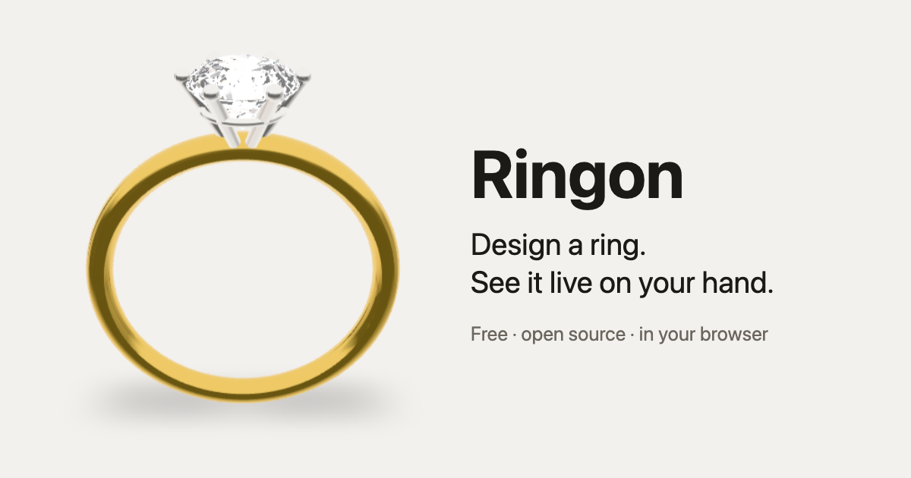

# Ringon

Design a ring, then see it live on your hand through your phone camera. Free and open source,
runs in the browser, installable as an app (PWA), works offline once loaded.

**Open it:** https://tupe12334.github.io/ringon/ (on your phone; the camera needs HTTPS)

[](https://tupe12334.github.io/ringon/)

## What you can do

- **Design by jeweler conventions** – ring size in US/CA, EU/ISO, UK/AU or JP charts; band
  profile, width, thickness, comfort fit and shank taper; 15 metals, 18 woods and 6 finishes, two-tone heads;
  15 stone shapes (incl. baguette, tapered baguette, trapezoid, half moon, trillion) sized by carat
  weight (and gem density); prong (4/6, round/claw/V tips), bezel (wall thickness, lip, plain /
  rounded / milgrain edge, half bezel open at the sides or ends) or tension settings; classic,
  double or hidden halo; inside engraving.
- **Wood rings** – solid (bentwood) wood bands, wood or crushed stone (turquoise, malachite, lapis,
  opal) inlays in metal or wood, a second pinstripe inlay, centred or offset, and liners: a metal
  core inside a wood ring or a wood-lined metal band.
- **Side stones** – three, five or seven stones or a toi et moi pair, each with its own shape, gem,
  size and graduation, orientation (pears pointing in or out, half moons flat edge to the centre),
  prong or bezel setting, gap and offset along the finger.
- **Band stones** – pavé, channel, full or half eternity in any cut, rows, coverage, spacing
  (stations) and bezel-set stones; combine with side stones.
- **Real-ring examples** – [templates rebuilt from jewelers' listings](src/templates/examples.ts),
  each linked to its source.
- **Templates** – start from classic designs, save your own, export/import them as JSON, or share
  a design as a link.
- **Live try-on** – point the camera at your hand: the ring follows your finger in real time,
  turns with it, and hides behind it like a real ring. Pick the finger, flip the stone side,
  fine-tune the fit, take a photo or record a video clip to share.
- **AI photo** – a ready-to-copy prompt for any image generator that describes the design, the
  hand, the finger and the kind of shot. Or generate the photo here with your own API key for
  OpenAI, Google Gemini, OpenRouter or fal.ai: Ringon sends the 3D view (or your own ring image)
  and, if you add one, a photo of your hand.

## How it works

| Part | Where |
|---|---|
| Ring sizes, design spec and validation | [`src/ring/sizes.ts`](src/ring/sizes.ts), [`src/ring/spec.ts`](src/ring/spec.ts) |
| Metal, gem and stone reference data | [`src/ring/catalog.ts`](src/ring/catalog.ts) |
| 3D geometry (band sweep, faceted gems, settings) | [`src/ring/geometry.ts`](src/ring/geometry.ts) |
| Templates, sharing, saved designs | [`src/templates/`](src/templates) |
| Hand tracking → ring pose | [`src/tryon/pose.ts`](src/tryon/pose.ts), [`src/tryon/TryOn.tsx`](src/tryon/TryOn.tsx) |
| AI photo prompt and image services | [`src/imagegen/prompt.ts`](src/imagegen/prompt.ts), [`src/imagegen/providers.ts`](src/imagegen/providers.ts) |

Rendering uses [three.js](https://threejs.org) via React Three Fiber; hand tracking uses
[MediaPipe Hand Landmarker](https://ai.google.dev/edge/mediapipe/solutions/vision/hand_landmarker),
served from this app (no third-party requests).

## Privacy

Everything runs on your device. The camera feed, hand tracking, photos and clips never leave the
browser unless you share them; designs and saved templates stay in this browser's storage. No
accounts or cookies. Each page load on the live site pings [hits.sh](https://hits.sh) once to count
visits. A browser's first visit pings a second counter to count users, and its first visit
each day pings a third to count daily users (flags in this browser's storage remember what was
counted; no id is sent). hits.sh sees your IP address and
nothing else. Counts are public:
[visits](https://hits.sh/tupe12334.github.io/ringon),
[users](https://hits.sh/tupe12334.github.io/ringon-users),
[daily users](https://hits.sh/tupe12334.github.io/ringon-daily-users). A share link carries the design itself in the part after `#`,
which browsers never send to a server. "Report a problem" in the try-on makes a file on your device
(a photo of your hand, the hand tracking data, the ring design and device details); it leaves the
device only if you send it, by download, the share sheet or a GitHub issue you attach it to.

AI photo: when you click **Generate photo**, the prompt, the ring image and your hand photo go
straight from the browser to the service you chose, and nowhere else; none of it is sent before you
click (choosing OpenRouter only loads its public model list). Your API key stays in the browser: in memory only, or in this browser's storage if you tick
"Remember the key".

## Develop

```sh
pnpm install
pnpm dev        # http://localhost:5173 — open on a phone via `pnpm dev --host` + an HTTPS tunnel
pnpm test       # unit tests
pnpm e2e        # browser tests, incl. live tracking on a fake camera feed (needs ffmpeg)
PORT=4199 pnpm e2e --project photos   # try-on on real hand photos; another port if 4173 is taken
```

Try-on accuracy is checked on real photos of hands in [`e2e/fixtures/photos/`](e2e/fixtures/photos):
[`truth.json`](e2e/fixtures/photos/truth.json) holds what was measured on them by hand (where real
rings sit, finger widths, which side faces the camera). `DUMP=1` on the photos project refreshes
the landmarks that [`src/tryon/photos.test.ts`](src/tryon/photos.test.ts) checks the pose against.

A try-on bug report (`ringon-report-<date>.json`, from "Report a problem"; schema in
[`src/tryon/report.ts`](src/tryon/report.ts)) holds the camera frame without and with the ring, the
last ~2 s of landmarks, raw and smoothed ring poses, settings, the design, camera and device. Turn
it into a photo fixture:

```sh
node scripts/report-to-fixture.mjs ringon-report-….json [name]   # writes e2e/fixtures/photos/<name>.jpg
```

It prints a `truth.json` entry to fill in by measuring the photo (and where the app drew the ring,
as a starting point). Add the photo to `ATTRIBUTION.md` (only with the reporter's consent), then
refresh the landmarks with `DUMP=1` as above.

## See also

- [moadim](https://moadim.io/) — loop engineering: build, schedule & run agent loops.

## License

MIT. The bundled hand landmark model (`public/models/hand_landmarker.task`) and the test hand
image are from Google MediaPipe, Apache-2.0. Test photos: see
[`e2e/fixtures/photos/ATTRIBUTION.md`](e2e/fixtures/photos/ATTRIBUTION.md). Wood textures (CC0 and
CC BY-SA photos): see [`public/textures/wood/ATTRIBUTION.md`](public/textures/wood/ATTRIBUTION.md).
